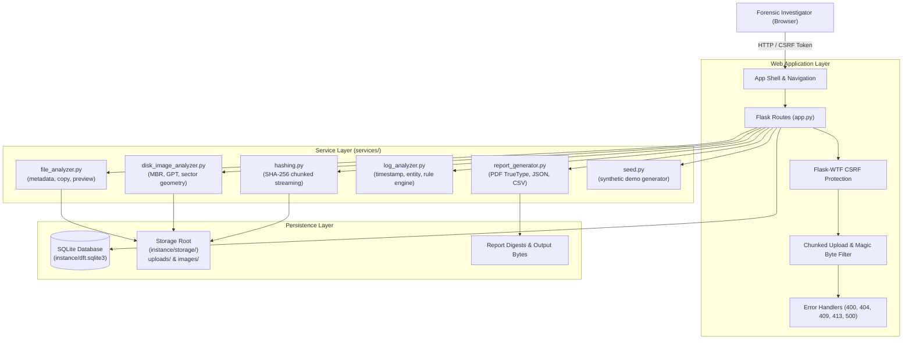
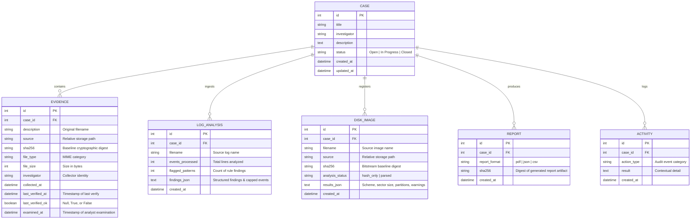

# System Architecture & Threat Model

This document outlines the architecture, data model, security design, and threat model of the **Digital Forensics Toolkit (DFT)**.

---

## 1. System Architecture

DFT is structured as a modular Flask 3 application with clean separation between HTTP route presentation, business services, storage persistence, and the SQLite relational ledger.

---

## 2. Relational Data Model

All investigative records are persisted within an isolated SQLite database via Flask-SQLAlchemy.

---

## 3. Storage Hierarchy & Path Privacy

To prevent leaking internal server directory paths across investigative exports and client browsers:
- Files are stored in `STORAGE_ROOT` under subdirectories `uploads/<uuid>.<ext>` or `images/<uuid>.<ext>`.
- Models record only relative paths (`uploads/9b1deb4d...csv`).
- Absolute filesystem paths are strictly stripped from JSON, CSV, and PDF exports.
- Path traversal sequences in client filenames (e.g., `../../etc/passwd`) are sanitized through `werkzeug.utils.secure_filename` before reaching the storage layer.

---

## 4. Threat Model & Security Scope

### What DFT Cryptographic Verification & Auditing Guarantees

| Security Property | Mechanism | Guarantee Provided |
| :--- | :--- | :--- |
| **Bitstream Integrity at Rest** | SHA-256 chunked hashing | Detects accidental bit rot, drive corruption, or unauthorized alteration of stored evidence files on disk. |
| **Verification Gate on Egress** | On-download hash comparison | Prevents serving altered or tampered evidence files to analysts; aborts with HTTP 409 Conflict. |
| **Tamper Demonstration** | In-place & download verification | Demonstrably catches modified evidence (such as the deliberate modification in the seeded demo case). |
| **Memory Exhaustion Defense** | 1 MB streaming blocks & per-route limits | Prevents Denial of Service via unbounded memory consumption during uploads or hash computations. |
| **Extension Spoofing Defense** | Magic-byte header inspection | Rejects Windows PE executables (`MZ`) and Linux ELF binaries (`\x7fELF`) masquerading as `.txt` or `.log` files. |
| **Cross-Site Request Forgery** | Flask-WTF CSRF tokens | All state-mutating requests (`POST`) require valid cryptographic session tokens. |
| **Offline Seclusion** | Self-hosted assets | Zero outbound HTTP/DNS requests; no vulnerability to CDN compromises or tracking. |

### What DFT Does NOT Guarantee (Honest Limitations)

1. **Host-Level Adversary Defense**: If an attacker gains administrative/root access to the host machine running DFT, they can overwrite both the SQLite database (the recorded SHA-256 baseline) and the file in storage simultaneously. DFT is an application-level ledger, not a hardware-backed HSM or blockchain.
2. **Multi-Tenant Access Isolation**: DFT has **no authentication or user privilege tiers**. Any user with network access to the running port can access all cases and trigger actions. DFT must only be run locally on a secured analyst workstation.
3. **Legal Proof of Malice**: Log analysis findings (such as failed login thresholds or directory traversal markers) represent **investigative leads**, not definitive proof. Network noise, automated scanners, or misconfigured client applications can produce matching patterns.
4. **Hardware Write-Blocking**: DFT does not enforce physical write-blocking. Forensic bitstream preservation requires write-blocking hardware or OS-level read-only mount flags before image creation.
