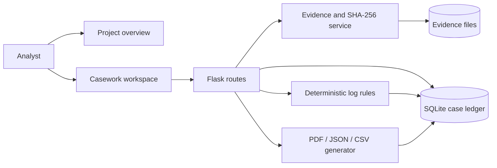

# Architecture and Deployment Notes

## Application flow

`create_app` configures the Flask application, SQLAlchemy, CSRF protection, upload limits, safe storage paths, and route handlers. Files are streamed to a generated relative path under `STORAGE_ROOT`; database records do not expose the server's absolute path. The log analyzer and report generator are isolated under `services/`.

## Records

- `Case` owns evidence, log analyses, reports, and activity entries.
- `Evidence` stores the original filename, relative storage reference, SHA-256 baseline, collector, and verification state.
- `LogAnalysis` stores event counts and structured findings for the uploaded source.
- `Report` records format and digest after report generation succeeds.
- `Activity` records case actions such as evidence registration, integrity results, analysis, and report generation.

## Render

The Blueprint uses Gunicorn, `/health`, and a persistent disk mounted at `/var/data`. SQLite is configured at `/var/data/dft.sqlite3`; uploaded files are stored at `/var/data/storage`. The service runs one instance because a local persistent disk is attached. `AUTO_SEED_DEMO=true` loads synthetic showcase records only when the database has no cases.

Render's default filesystem is ephemeral. Persistent disks are available to paid web services and preserve only data written below the configured mount path. The app has no authentication, so public deployments must use synthetic data only.

## Security and limits

- Flask-WTF CSRF protection covers state-changing form requests.
- Upload names are sanitized and storage names are generated. Upload limits are enforced while streaming.
- Evidence downloads are served only if a fresh SHA-256 check matches the registered baseline; failures are recorded and return HTTP 409.
- Evidence previews read a bounded byte range and are served as JSON.
- Log rules produce investigative leads and may match benign activity.
- The database and storage remain under the same host administrator's control. Hashes detect changes; they do not make the ledger tamper-proof.
- No account system, multi-tenant isolation, filesystem mounting, or disk-image analysis is provided.
