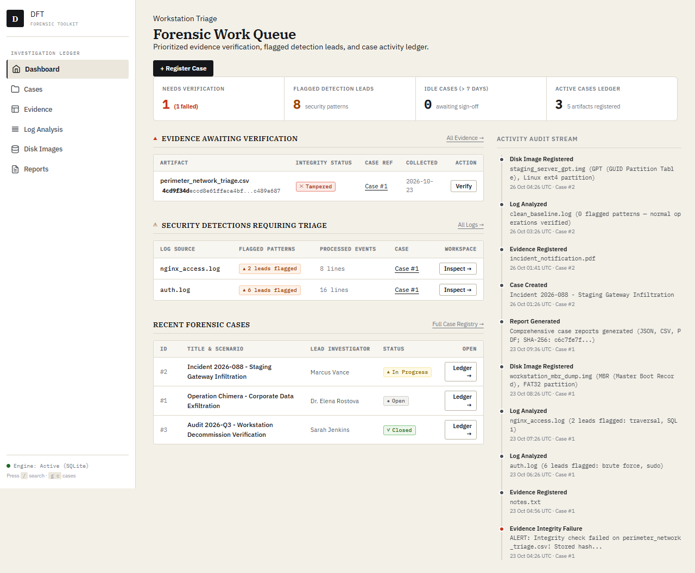
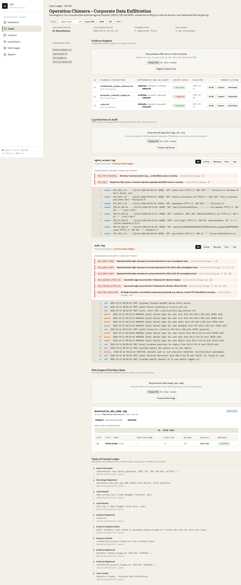
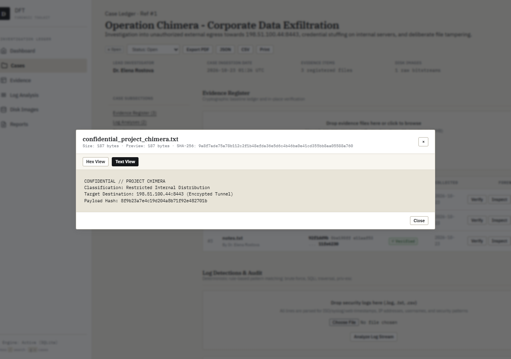

# Digital Forensics Toolkit (DFT)

> **Academic Prototype Notice & Honest Scope**:
> DFT is a single-user academic forensic workbench designed for local investigative triage.
> - **Findings are investigative leads, not conclusive proof** of malicious activity or legal culpability.
> - **No authentication**: DFT is strictly single-user and unauthenticated by design; run exclusively in trusted local environments.
> - **Tamper detection, not tamper prevention**: SHA-256 cryptographic baselines detect bitstream alteration of stored files at rest; they do not guarantee protection against an attacker with root database access.
> - **100% Offline**: All assets, fonts (IBM Plex), and stylesheets are self-hosted with zero external CDN dependencies.

---

## Visual Interface Overview

The interface follows a dense, tool-like **Forensic Lab Ledger** design system: warm paper palette, hairline borders, monospace hash blocks with click-to-copy, and distinct WCAG AA colorblind-safe semantic severity indicators.

### 1. Forensic Work Queue & Operational Dashboard
*Prioritized triage queues replacing vanity counters: items awaiting verification, flagged detection leads, and idle investigations.*


### 2. Case Workspace & Left-Rail Artifact Ledger
*Comprehensive investigation workbench featuring chain-of-custody timelines, partition maps, log analysis panes, and export options.*


### 3. In-Place Cryptographic Verification & File Inspection
*Modal-driven evidence inspection with immediate SHA-256 verification and previewing.*


---

## 5-Minute Quickstart

DFT supports both `make` and `just` task runners, as well as native shell commands.

### Option A: Using `make` (Recommended)

```bash
# 1. Setup virtual environment and install pinned dependencies
make setup

# 2. Seed synthetic forensic cases with sample evidence & tampered file test
make seed

# 3. Start local development server
make run
```
Navigate to **http://127.0.0.1:5000**.

### Option B: Using `just`

```bash
just setup
just seed
just run
```

### Option C: Manual Python Setup (Windows PowerShell)

```powershell
# Create and activate environment
python -m venv .venv
.venv\Scripts\Activate.ps1

# Install runtime and development dependencies
pip install -r requirements.txt
pip install -r requirements-dev.txt

# Generate synthetic disk images & seed demo database
python scripts/make_sample_images.py
flask seed --reset

# Run application
python app.py
```

### Running Tests & Linting

```bash
# Run full pytest suite with coverage check on services/ (targets >=85%)
make test

# Run ruff linter and formatting checks
make check
```

---

## Core Capabilities

### 1. Cryptographic Evidence Ledger
- **Deterministic Hashing**: Chunks large evidence and raw bitstreams through SHA-256 in 1 MB blocks without consuming unbounded RAM.
- **In-Place Verification**: One-click asynchronous integrity verification without re-downloading files.
- **Download Integrity Gate**: Automatically recalculates bitstream SHA-256 before serving downloads. If an on-disk byte has altered, the download is aborted with an HTTP 409 Conflict error and an audit violation is recorded.
- **Independent State Tracking**: Tracks `last_verified_at` and `last_verified_ok` per evidence row, ensuring duplicate filenames remain isolated.

### 2. Forensic Disk Image Analyzer
- **MBR & GPT Support**: Decodes Master Boot Record partition tables and full 92-byte GUID Partition Table (GPT) headers across 512-byte and 4096-byte logical sectors.
- **GUID Type Resolution**: Translates raw 128-bit GUIDs into human-readable partition types (EFI System, Microsoft Basic Data, Linux Filesystem, Swap, Solaris, etc.).
- **Proportional Geometry Map**: Visual bar rendering partition layout relative to total sector count.
- **Structured Warnings**: Non-silent parsing that surfaces corrupt headers, backup LBA anomalies, and truncated sector arrays in a structured warning ledger.

### 3. Deterministic Log Analysis Engine
- **Universal Evaluation**: Evaluates all log lines across detection rules rather than relying on search-term filters. Filters are applied only to the resulting event view.
- **Multi-Format Timestamps**: Parses ISO-8601 (`2026-10-12T08:14:00Z`), Syslog (`Oct 12 08:12:10`), Apache/Nginx combined (`[12/Oct/2026:09:14:02 +0000]`), and Windows Event Log timestamps.
- **Explicit Detection Rules**:
  - `RULE_BRUTE_FORCE`: Identifies repeated authentication failures per IP or user within a configurable sliding time window.
  - `RULE_SUCCESS_AFTER_FAIL`: Detects successful authentications following prior failed attempts for an identity.
  - `RULE_PATH_TRAVERSAL`: Catches relative path escapes (`../`, `..\\`, `%2e%2e%2f`).
  - `RULE_SQLI`: Flags SQL injection payloads (`UNION SELECT`, boolean injection, `DROP TABLE`).
  - `RULE_SENSITIVE_ACCESS`: Flags attempts to access `/etc/shadow`, `/etc/passwd`, SAM, or NTDS hives.
  - `RULE_PRIV_ESCALATION`: Detects `sudo su`, `chmod 777`, `whoami /priv`, and related elevation commands.
  - `RULE_OFF_HOURS`: Surfaces anomalous activity occurring outside business hours (22:00-06:00 or weekends).
- **Event Capping**: Retains the first 2,000 baseline events plus all flagged anomaly lines, avoiding database exhaustion while capturing forensic leads.

### 4. Forensic Report Generation
- **Cryptographic Audit Binding**: Computes and records the SHA-256 digest of every generated report directly on the `Report` ledger row.
- **TrueType Unicode PDF**: ReportLab engine embeds self-hosted IBM Plex TrueType fonts, cleanly rendering non-ASCII forensic strings without `?` glyph replacement.
- **Multiple Formats**: PDF, JSON, and CSV exports with server filesystem paths sanitized to relative storage identifiers.

---

## Synthetic Sample Data & Demo Mode

The `/sample_data/` directory contains purely synthetic forensic artifacts (all fake):
- `auth.log`: Synthetic SSH brute-force attack from multiple IP addresses followed by a credential compromise.
- `nginx_access.log`: Web server access stream with directory traversal and SQL injection probes.
- `windows_security.csv`: Windows Security Event Log export featuring Event IDs 4625 (Logon Failure) and 4624 (Logon Success).
- `clean_baseline.log`: Benign background log producing zero findings to verify negative-case rule fidelity.
- `mbr_fat.img`, `gpt_ext4.img`, `raw_unpartitioned.dd`, `corrupt_header.img`: Deterministic synthetic disk images built via `scripts/make_sample_images.py`.

### Built-in Tamper Demonstration

Running `make seed` or clicking **Load Synthetic Demo Data** generates:
1. **Operation Chimera** (Open status)
2. **Project Aegis** (In Progress status)
3. **Internal Audit 2026-Q1** (Closed status)

In **Operation Chimera**, evidence item `perimeter_network_triage.csv` is **deliberately modified on disk** after registration. Attempting to verify or download this file immediately demonstrates an HTTP 409 Conflict integrity failure and logs an audit violation.

---

## Architecture & Configuration

| Configuration Parameter | Default Value | Description |
| :--- | :--- | :--- |
| `STORAGE_ROOT` | `instance/storage` | Authorized directory for raw evidence and disk bitstreams. |
| `MAX_CONTENT_LENGTH` | `2 GB` | Global request size ceiling. |
| `MAX_EVIDENCE_CONTENT_LENGTH` | `64 MB` | Upload limit for general evidence files (`.txt`, `.pdf`, `.csv`, `.json`). |
| `MAX_LOG_CONTENT_LENGTH` | `32 MB` | Upload limit for security logs. |
| `MAX_DISK_IMAGE_CONTENT_LENGTH` | `2 GB` | Upload limit for raw disk images (`.dd`, `.img`). |
| `SECRET_KEY` | *(Environment)* | Session secret key. Application refuses to start in non-debug mode with default secret. |

For detailed architectural diagrams, data models, and threat models, see [ARCHITECTURE.md](ARCHITECTURE.md).

---

## Honest Limitations

1. **Single-User Academic Prototype**: DFT does not implement user accounts, role-based access control, or session authentication gates.
2. **No Hardware Write-Blocker Integration**: Evidence ingestion relies on standard file copies and streaming writes; hardware write-blocking must be managed at the OS or hardware layer.
3. **No Direct Filesystem Driver Mounting**: Disk image analysis decodes partition table structures (MBR/GPT) and verifies raw bitstream integrity, but does not mount filesystems (e.g. ext4, NTFS) in-kernel.
4. **Audit Scope**: Activity logs are stored within SQLite and prove internal tool operation; they do not withstand an adversary with physical or administrative access to the underlying server.
