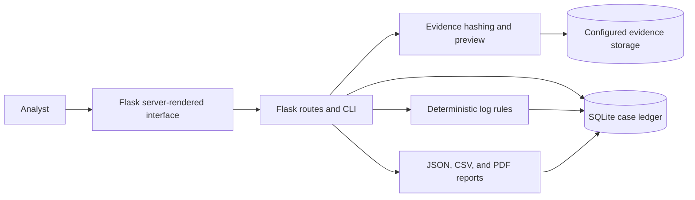

# Digital Forensics Toolkit

Digital Forensics Toolkit (DFT) is a single-user Flask workbench for organizing synthetic digital-evidence cases, registering files with cryptographic baselines, reviewing supported security logs with deterministic rules, and generating case reports. It is intended for academic triage and demonstration: rule matches are investigative leads, not conclusions.

## Overview

DFT keeps case records in SQLite and stores uploaded files below a configurable storage directory. When evidence is registered, the application calculates and records MD5, SHA-1, and SHA-256 metadata; integrity verification and download access compare the current file bytes against the stored SHA-256 baseline. A separate log-analysis workflow applies local pattern rules to supported text-based logs and saves structured findings with the case. Reports can be generated as JSON, CSV, or PDF.

The included showcase loader creates three synthetic cases, including one intentionally altered file for demonstrating an integrity failure. It operates on sample data in this repository and is not suitable for real sensitive evidence in a public deployment.

## Features

- Create, search, filter, paginate, and update case records with activity history.
- Register supported evidence types (`.txt`, `.log`, `.csv`, `.json`, `.pdf`, `.zip`, `.doc`, and `.docx`) with generated storage names and streamed hash calculation.
- Preview up to 8,192 bytes of stored evidence as bounded text and hexadecimal data.
- Verify SHA-256 integrity in place; evidence downloads are blocked with HTTP 409 if verification fails.
- Analyze supported log files (`.log`, `.txt`, and `.csv`) for failed/successful authentication sequences, path traversal, SQL-injection patterns, sensitive-file references, privilege-escalation commands, and qualifying off-hours events.
- Generate JSON, CSV, and PDF case reports and record each generated report's SHA-256 digest in the case ledger.
- Seed a synthetic three-case showcase with clean and flagged logs, intact files, and deliberately tampered evidence.
- Serve a server-rendered interface with health endpoint at `GET /health`.

## Architecture



`create_app` in [`app.py`](app.py) initializes Flask, SQLAlchemy, CSRF protection, local storage, database tables, and route handlers. `models.py` defines cases, evidence, log analyses, reports, and activities. The `services/` package contains hashing, file preview, log analysis, report generation, and synthetic-data seeding. More implementation and deployment notes are in [`ARCHITECTURE.md`](ARCHITECTURE.md).

## Technology

| Area                           | Verified implementation                                |
| ------------------------------ | ------------------------------------------------------ |
| Language                       | Python; CI and container configuration use Python 3.12 |
| Web framework                  | Flask 3.1.0                                            |
| Persistence                    | Flask-SQLAlchemy 3.1.1 with SQLite by default          |
| Forms and CSRF                 | Flask-WTF 1.2.2                                        |
| PDF reports                    | ReportLab 4.2.5                                        |
| Production server              | Gunicorn 23.0.0                                        |
| Tests                          | pytest 8.3.4, pytest-cov, and Playwright               |
| Static analysis and formatting | Ruff                                                   |
| Container base                 | `python:3.12-slim`                                   |

Exact runtime dependencies are pinned in [`requirements.txt`](requirements.txt). Development-only tools are listed in [`requirements-dev.txt`](requirements-dev.txt); `pytest-cov`, Ruff, and Playwright use minimum versions there.

## Prerequisites

- Python 3.12, matching the continuous-integration workflow and Docker image.
- `pip` and a Python virtual environment.
- `make` or `just` only when using the corresponding task-file shortcuts.
- Docker Desktop only for the container workflow.

No external database, cloud account, model files, datasets, or API credentials are required for local use. The default database is SQLite.

## Installation and local run

From the repository root, create and activate a virtual environment, then install the development dependencies:

```powershell
python -m venv .venv
.venv\Scripts\Activate.ps1
python -m pip install -r requirements-dev.txt
```

Copy the tracked environment template if you want to change the local defaults:

```powershell
if (-not (Test-Path .env)) {
    Copy-Item .env.example .env
}
```

Start the development server:

```powershell
.venv\Scripts\flask.exe --app app run --debug --port 5000
```

Open `http://127.0.0.1:5000`. The application creates the SQLite database and storage directory when the app is initialized.

### Task-file shortcuts

The repository supplies equivalent `Makefile` and `justfile` targets:

```powershell
make setup
make run
```

or:

```powershell
just setup
just run
```

`setup` creates `.venv` and installs `requirements-dev.txt`; `run` starts Flask in debug mode on port 5000. The task files invoke executables from the virtual environment on Windows when run through `make`.

## Configuration

`config.py` loads a repository-root `.env` file when it exists, without requiring an additional dotenv package. Existing process environment variables take precedence over values in `.env`.

| Variable                        | Required                                   | Description                                                                                                | Default                     |
| ------------------------------- | ------------------------------------------ | ---------------------------------------------------------------------------------------------------------- | --------------------------- |
| `SECRET_KEY`                  | Yes for non-debug, non-test server startup | Flask secret key. The application refuses non-debug startup when this remains the insecure built-in value. | `change-me-in-production` |
| `DATABASE_URL`                | No                                         | SQLAlchemy database connection URL.                                                                        | `sqlite:///dft.sqlite3`   |
| `STORAGE_ROOT`                | No                                         | Root directory for uploaded evidence and generated files.                                                  | `instance/storage`        |
| `AUTO_SEED_DEMO`              | No                                         | Set to `true` to load synthetic showcase records when the database has no cases.                         | `false`                   |
| `MAX_CONTENT_LENGTH`          | No                                         | Flask request-size limit, in bytes.                                                                        | `69206016` (66 MiB)       |
| `MAX_EVIDENCE_CONTENT_LENGTH` | No                                         | Evidence-upload limit, in bytes.                                                                           | `67108864` (64 MiB)       |
| `MAX_LOG_CONTENT_LENGTH`      | No                                         | Log-upload limit, in bytes.                                                                                | `33554432` (32 MiB)       |

The provided [`.env.example`](.env.example) lists `SECRET_KEY`, `DATABASE_URL`, `STORAGE_ROOT`, and `AUTO_SEED_DEMO`. Container and Render defaults override the database and storage paths to persistent locations under `/var/data`.

## Usage

### Load the synthetic showcase

Run the Flask CLI command after installing dependencies:

```powershell
.venv\Scripts\flask.exe --app app seed --reset
```

This resets only the three named synthetic showcase cases before rebuilding their evidence, logs, and reports. It does not delete other case records. You can then start the application with:

```powershell
.venv\Scripts\python.exe app.py
```

Because `app.py` starts with debug mode disabled, set a non-default `SECRET_KEY` before using that command. Alternatively, use the debug-server command in [Installation and local run](#installation-and-local-run).

To run the test suite, reset the showcase, and start the debug server in sequence:

```powershell
make showcase
```

The same workflow is available as `just showcase`.

### Web workflows

1. Open the workspace at `http://127.0.0.1:5000/workspace`.
2. Create a case from the **Cases** area.
3. Add evidence from the case workspace. Allowed evidence extensions and size limits are enforced during streaming upload.
4. Use the evidence preview or verification actions. A failed integrity check prevents download and records activity.
5. Upload a supported log file for rule-based analysis. Review saved findings as leads requiring analyst assessment.
6. Open **Reports** or a case report route to generate a JSON, CSV, or PDF report.

The health check is available at `http://127.0.0.1:5000/health` and returns a JSON object with `status` set to `ok`.

## Project structure

```text
.
├── app.py                  Flask application factory, routes, and seed CLI command
├── config.py               Environment loading and application configuration
├── models.py               SQLAlchemy models for cases, evidence, logs, reports, and activity
├── services/               Hashing, previews, deterministic log rules, reports, and seed data
├── templates/              Server-rendered HTML templates
├── static/                 CSS, JavaScript, self-hosted fonts, and images
├── sample_data/            Synthetic files used by tests and the showcase
├── tests/                  pytest and Playwright coverage
├── docs/screenshots/       Checked-in application screenshots
├── Dockerfile              Production-image definition
├── docker-entrypoint.sh    Persistent-data directory setup and privilege drop
├── render.yaml             Render Blueprint definition
├── requirements.txt        Runtime dependencies
└── requirements-dev.txt    Development and test dependencies
```

## Testing and quality checks

Run the tests with service coverage:

```powershell
.venv\Scripts\python.exe -m pytest --cov=services --cov-report=term-missing --cov-fail-under=85
```

Run the linter:

```powershell
.venv\Scripts\ruff.exe check .
```

The CI workflow also checks formatting without modifying files:

```powershell
.venv\Scripts\ruff.exe format --check .
```

The task files expose `test`, `lint`, `format`, and `check` targets (`format` applies formatting; CI uses the non-mutating `ruff format --check .`). CI runs on pushes and pull requests targeting `main`, uses Python 3.12, and requires a service-coverage threshold of 85%.

Verification performed for this README: the test command passed with 66 tests and 96.48% service coverage, and `ruff check .` passed. `ruff format --check .` currently reports formatting changes in three tracked test files; this README change intentionally does not reformat unrelated files.

## Docker

Build the image:

```powershell
docker build -t dft .
```

Run it with a named volume for the SQLite ledger and stored files:

```powershell
docker run --rm -p 5000:10000 -e "SECRET_KEY=local-demo-secret-change-this" -e "AUTO_SEED_DEMO=true" -v dft-data:/var/data dft
```

Open `http://127.0.0.1:5000`. The image runs Gunicorn on port 10000 with one worker and four threads. Its entrypoint creates `/var/data` and the configured storage directory, then runs the server as the non-root `dft` user. The named volume retains SQLite and evidence data across container restarts.

## Render deployment

[`render.yaml`](render.yaml) defines one Docker web service named `digital-forensics-toolkit` with:

- a `/health` health-check path;
- a 1 GB disk mounted at `/var/data`;
- `DATABASE_URL=sqlite:////var/data/dft.sqlite3`;
- `STORAGE_ROOT=/var/data/storage`;
- `AUTO_SEED_DEMO=true`; and
- a generated `SECRET_KEY`.

To deploy that Blueprint, commit and push the repository to GitHub, then create a Render Blueprint from the repository and apply the detected [`render.yaml`](render.yaml). The configuration requests Render's `starter` plan and attaches a disk, so it runs as a single instance with local persistent storage.

## Security and scope limitations

- The application has no authentication, roles, or multi-user isolation. Public deployments should use synthetic data only.
- Hashes detect changes to registered file bytes; they do not prevent a host administrator from modifying both the database and storage.
- Log detections are deterministic pattern matches. They are not proof of intent or compromise.
- The application analyzes uploaded log files and bounded evidence previews. It does not mount or analyze disk images.
- Evidence storage and the SQLite database are local to the configured host or persistent disk; this is not a multi-user production evidence-vault design.


<!-- NEEDS INPUT: No LICENSE file is present in this repository. Add a license file and replace this notice with its verified identifier. -->
